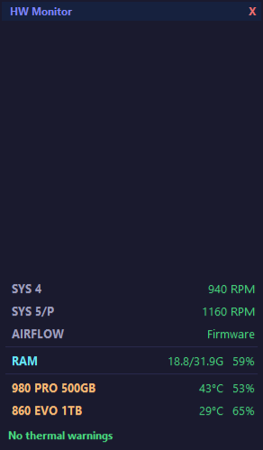

<h1 align="center">HeatMap</h1>

Hardware temperatures, load, memory and fan readings on the Windows desktop.

  <a href="https://github.com/Antrakt92/HeatMap/releases/latest">Download Python app</a>
  · <a href="docs/SETUP.md">Setup</a>
  · <a href="docs/REFERENCE.md">Sensor and cooling reference</a>
  · <a href="https://github.com/Antrakt92/HeatMap/issues">Report a problem</a>

  
  
  

Keep hardware readings on your desktop. HeatMap normally sits beneath
application windows, with optional Always on top and edge-hover modes. Drag the
title bar to position it; the app remembers its location.

## What it shows

| Component | Metrics |
|-----------|---------|
| **CPU** | Package/Tctl temperature, highest reported core frequency, load (%), RPM of both fans, and percentage when available |
| **GPU** | Core, Hotspot, and memory temperatures on separate rows, load (%), VRAM, and fans |
| **RAM** | Used/total GiB and usage (%) from one Windows memory snapshot |
| **Drives** | One compact row per volume: drive letter, device model, temperature, and fullness (%) |
| **Case** | RPM and available percentage for each SYS header; controller warnings when needed |
| **Warnings** | Overheating, a large Hotspot–Core difference, a previously spinning fan stopping under load, and memory/disk usage |

CPU, GPU and RAM readings update every two seconds; storage readings update
approximately every 30 seconds. Missing or expired readings stay marked as
unavailable. Use **Display → Details** for additional metrics and
**Diagnostics → Copy diagnostics** for a technical report.

*Earlier interface version shown.*

## Installation

HeatMap requires **64-bit Windows, 64-bit Python 3.10 or newer and administrator
access for hardware sensors**. The release ZIP contains the Python application;
it is not a standalone executable installer.

1. Download and extract the [latest release](https://github.com/Antrakt92/HeatMap/releases/latest),
   or clone this repository.
2. Follow the [setup guide](docs/SETUP.md) to create a virtual environment,
   install the pinned dependencies and prepare the verified monitoring runtime.
3. Start `run_as_admin.bat` and accept the Windows UAC prompt.

The setup guide also covers the PawnIO driver needed for CPU and motherboard
sensors. Runtime and driver downloads are verified before use.

## Controls

| Action | Control |
|---|---|
| Move the overlay | Drag the title bar |
| Open settings | Click the gear button |
| Keep it above windows | Display → Always on top |
| Raise it temporarily | Display → Raise on edge |
| Start with Windows | Display → Autostart; sensor access still prompts for UAC |
| Change alerts and thresholds | Alerts & limits |
| Inspect readings and controller status | Diagnostics |

## Optional fan control

Monitoring and fan control are separate. Automatic fan control starts only
after the matching profile has been explicitly commissioned. Supported profiles
target specific Gigabyte B550/B850 motherboards and the Gigabyte RX 7900 XT
Gaming OC; they do not provide generic support for every board or GPU.

Read the [sensor and cooling reference](docs/REFERENCE.md) before enabling a
profile. It describes exact hardware, activation commands, restoration behavior,
conflicts and limitations. Temperature colors are application warning thresholds,
not manufacturer safety limits or proof of hardware damage.

## Help and development

For a problem, include your HeatMap version, Windows version, relevant hardware,
steps to reproduce and a redacted diagnostic report. Review reports before
posting; they can contain device identifiers and local paths.

See [CONTRIBUTING.md](CONTRIBUTING.md) for checks and source layout,
[CHANGELOG.md](CHANGELOG.md) for release history and the
[setup guide](docs/SETUP.md) for missing-runtime or driver problems.

## License

HeatMap uses the [MIT license](LICENSE). Bundled runtime components retain
their own terms; see [third-party notices](THIRD_PARTY_NOTICES.md).
